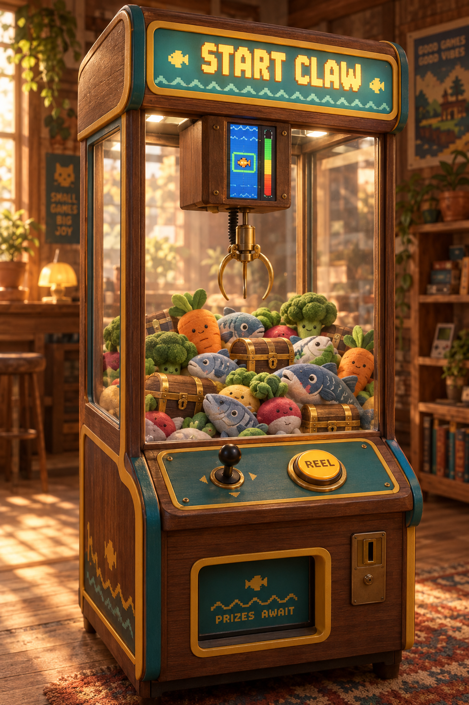

# START CLAW

A claw machine where the claw's grip isn't left to a hidden payout timer. **You earn it.**

The gantry carriage, the box that rides the rails and holds the claw motor, has a tall, narrow screen on its front face. When you press **REEL** to drop the claw, a fishing minigame in the style of Stardew Valley starts on that screen. It runs while the claw descends. How well you play decides how hard the claw grips.



## Repo layout

| Path                         | What                                                                  |
| ---------------------------- | --------------------------------------------------------------------- |
| `docs/concept.md`            | Product concept, player flow, and why the screen sits on the carriage |
| `docs/minigame.md`           | Minigame rules, tuning parameters, and prize tiers                    |
| `docs/hardware.md`           | Carriage box layout, electronics, and draft BOM                       |
| `designs/concept-render.png` | AI concept render (GPT Image)                                         |
| `designs/carriage-box.svg`   | Dimensioned front and side views of the carriage box                  |
| `prototype/index.html`       | Playable browser prototype of the minigame                            |

## Try the prototype

Open `prototype/index.html` in a browser. Hold **Space**, the mouse button, or a finger on the screen to lift the catch bar.

## Formatting

```bash
yarn format
```
