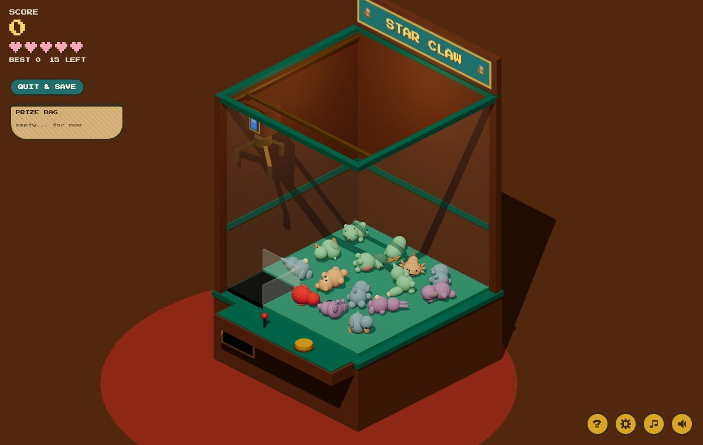
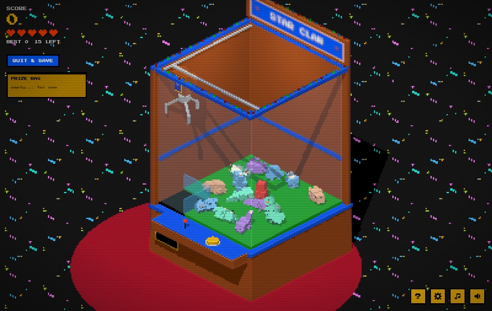
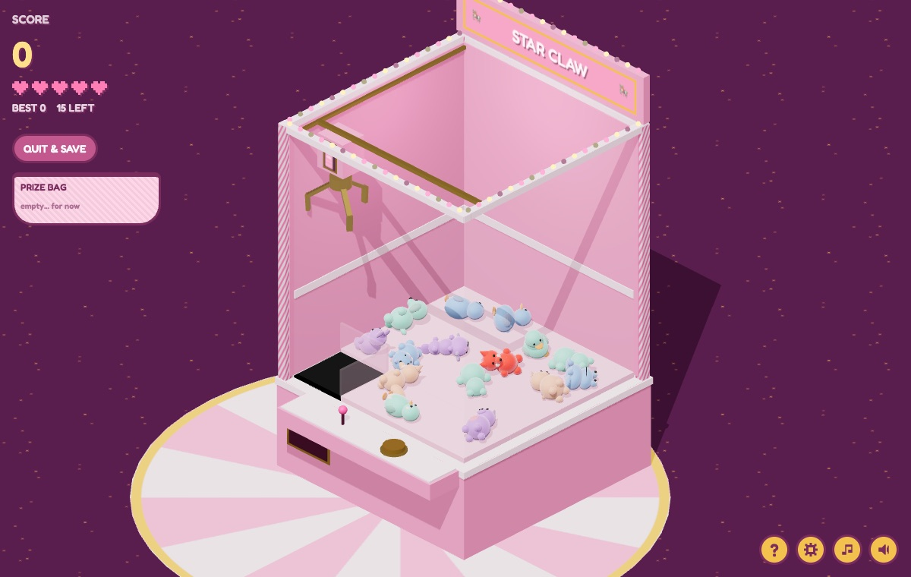
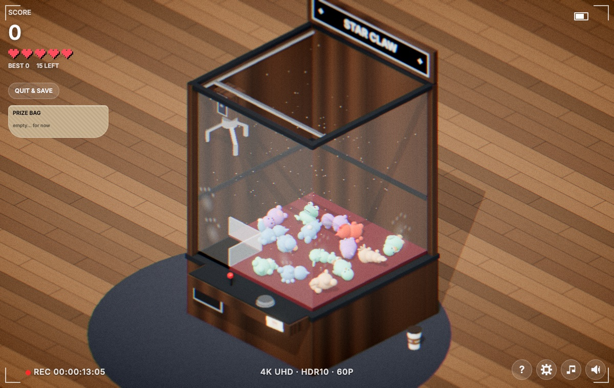
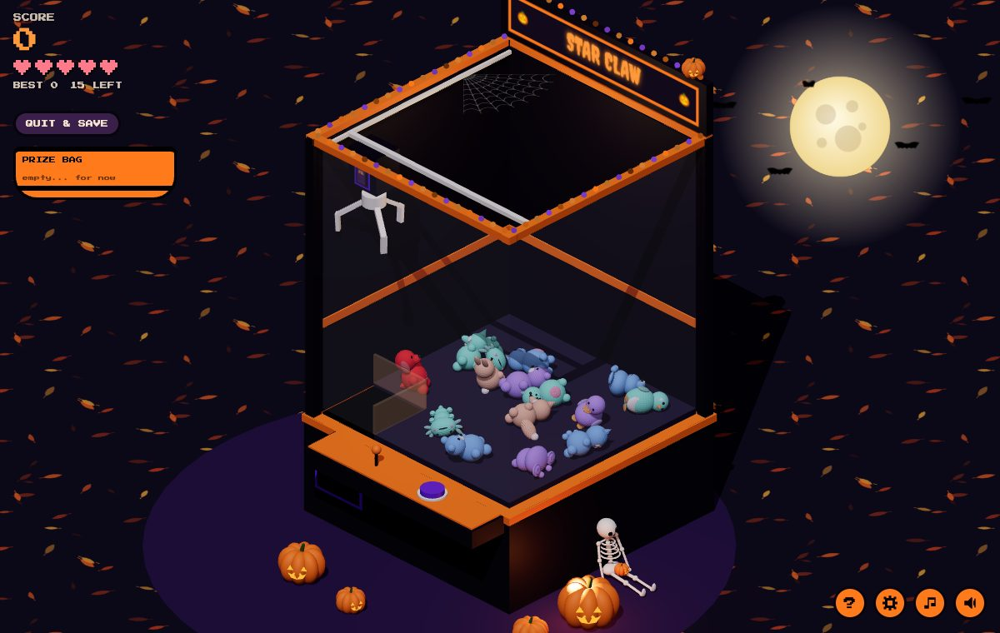

# STAR CLAW

A claw machine where the grip isn't left to a hidden payout timer. **You earn it.**

**[Play it at starclawmachine.com](https://starclawmachine.com)**. It's free, runs in any browser with WebGL, and works on phones. The world high score board needs a connection; everything else works offline once loaded.



Drop the claw on a knitted plushie. As it lifts, a fishing-style reel game starts on the little screen on the claw's carriage, and how well you play it sets how hard the claw grips on the way to the chute. Win the reel and it holds tight. Lose it and the plushie slips out.

The physics is real (cannon-es), so a sloppy grab can still nudge a plushie into the chute, and a perfect reel can still drop one on the edge.

## How to play

|                | Keyboard   | Touch          |
| -------------- | ---------- | -------------- |
| Move the claw  | Arrow keys | Drag           |
| Drop           | Space      | Tap            |
| Reel           | Hold Space | Hold anywhere  |
| Cash out       | Q          | QUIT & SAVE    |
| Help, settings | H, O       | ?, gear button |
| Music, sound   | M, S       | Note, speaker  |

The machine holds 15 plushies: ten animals, five colours. The animal is only the shape. The colour sets how hard the reel is and what it's worth:

| Colour | Points | Stocked |
| ------ | ------ | ------- |
| Mint   | 10     | 5       |
| Sky    | 25     | 4       |
| Lilac  | 50     | 3       |
| Peach  | 100    | 2       |
| Cherry | 250    | 1       |

- A perfect reel (the plushie never leaves the green bar) pays x1.5. Back-to-back catches build a streak up to x3.
- You start with 5 hearts. An empty grab or a dropped plushie costs half a heart. Losing the reel costs a whole one. Every catch heals half a heart.
- Cashing out pays 25 points per half heart left. Clearing the machine pays 500, plus 100 per heart.
- Your top 5 stays in the browser. The world top 10 lives in a Supabase table that anyone can read and add to, and nobody can edit.
- Every colour and animal pair you win goes into your collection: 50 in all.
- Clear the machine in one run to open the next level. Level 2, the arcade, is stocked with plush
  cabinets and customers, and the customers wander the floor. Level 3, the city, is coming.

The music speeds up as the machine empties. With one plushie left it's 30% faster than at the start, with double-time hats and the melody doubled an octave up.

## Themes

Settings has five themes. They change how the game looks and sounds: the cabinet, the floor, the plushies, the menus, the reel screen, the music and the sound effects. The physics and the scoring are the same in all five.

| 8-bit                                      | Pink carousel                                         | Ultra real 4K                                     | Halloween                                          |
| ------------------------------------------ | ----------------------------------------------------- | ------------------------------------------------- | -------------------------------------------------- |
|  |  |  |  |

- **8-bit**: voxel plushies on an arcade carpet, chase lights, pixel-art outlines and CRT scanlines. The music is a bit-crushed chiptune, and the coin and one-up sounds are the classic ones. The marquee blinks INSERT COIN.
- **Pink carousel**: candy-striped posts, twinkling bulbs, velvet plushies and an organ waltz.
- **Ultra real 4K**: chrome, wood grain, glass with fingerprints on it, dust in the lamp light, tilt-shift and film grain. Somebody left their coffee on the floor, and a camcorder is recording the whole thing. It renders at up to 3x the screen's pixels with a 4096px shadow map and seven post-processing passes, so older phones will stutter.
- **Halloween**: a black and orange cabinet with candle-flicker bulbs, jack-o'-lanterns on a floor of fallen leaves, a skeleton sitting against the machine with a pumpkin on its lap, a cobweb in the corner, bats across a full moon, and a haunted organ in D minor.

**Aim assist** draws a laser from the claw to whatever it would land on. Runs played with it on stay off both high score boards, and switching it on or off restarts the current run, so you can't switch it mid-game.

## Develop

You need Node 22 or later and Yarn 1.

```bash
git clone https://github.com/melucasleite/star-claw-machine.git
cd star-claw-machine
yarn            # install
yarn dev        # http://localhost:3000
yarn test       # rule unit tests (node:test, no browser)
yarn test:e2e   # browser tests; start yarn dev first (BASE_URL, default http://localhost:3000)
yarn format     # prettier
```

The app is Next.js (App Router), but the game is plain JavaScript that writes to the DOM directly. `src/app/Game.js` renders the markup once, then loads `src/game/main.js`, and the modules under `src/game/` take it from there. They're split by job:

| Module                                              | What it does                                                                                      |
| --------------------------------------------------- | ------------------------------------------------------------------------------------------------- |
| `config.js`, `rules.js`                             | Tuning numbers, and the scoring and turn rules as pure functions                                  |
| `game.js`, `reel.js`                                | The turn state machine (aim, drop, grab, lift, reel, release) and the reel game                   |
| `scene.js`, `physics.js`                            | Renderer, camera, lights, materials; the cannon-es world                                          |
| `cabinet.js`, `claw.js`, `plushies.js`              | The machine, the claw and its servo-driven prongs, and the knitted plushies                       |
| `levels.js`, `stages.js`, `arcade.js`, `walkers.js` | The levels and how they unlock, each level's set dressing, the arcade prizes, the customers' walk |
| `input.js`, `hud.js`, `overlays.js`, `help.js`      | Keys and touch, the scoreboard, the title and end screens, help                                   |
| `settings.js`, `settingsui.js`, `themes.js`         | Saved settings, the settings dialog, and every theme's look and sound                             |
| `textures.js`, `postfx.js`, `photo.js`              | Procedural textures, post-processing passes, the 4K theme's props                                 |
| `audio.js`, `music.js`                              | Synthesised sound effects and music (Web Audio, no sound files)                                   |
| `laser.js`, `confetti.js`, `bag.js`, `screen.js`    | Aim assist, confetti, the prize bag, the carriage screen                                          |
| `loop.js`, `sync.js`, `main.js`, `debug.js`         | Fixed-step loop, physics to mesh sync, boot, and the `window.__claw` console handle               |

Pushes to `main` deploy to [starclawmachine.com](https://starclawmachine.com) on Vercel.

## The physical machine

This started as a design for a real cabinet, and the docs for it are here too:

| Path                         | What                                                                   |
| ---------------------------- | ---------------------------------------------------------------------- |
| `docs/concept.md`            | Product concept, player flow, and why the screen rides on the carriage |
| `docs/minigame.md`           | Reel game rules, tuning and prize tiers                                |
| `docs/hardware.md`           | Carriage box layout, electronics and draft BOM                         |
| `cad/claw/`                  | The printed claw and drop winch (OpenSCAD, STLs, renders)              |
| `designs/carriage-box.svg`   | Dimensioned views of the carriage box                                  |
| `designs/concept-render.png` | Concept render                                                         |
| `public/minigame-2d.html`    | The first 2D sketch of the reel game                                   |
