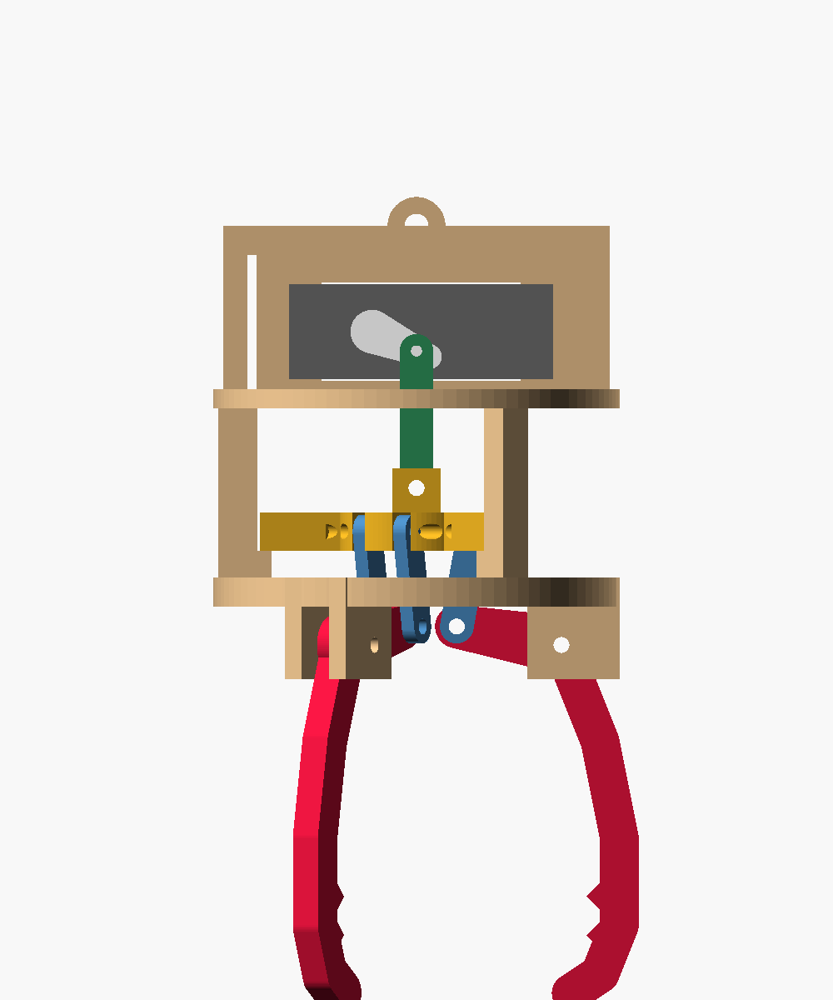
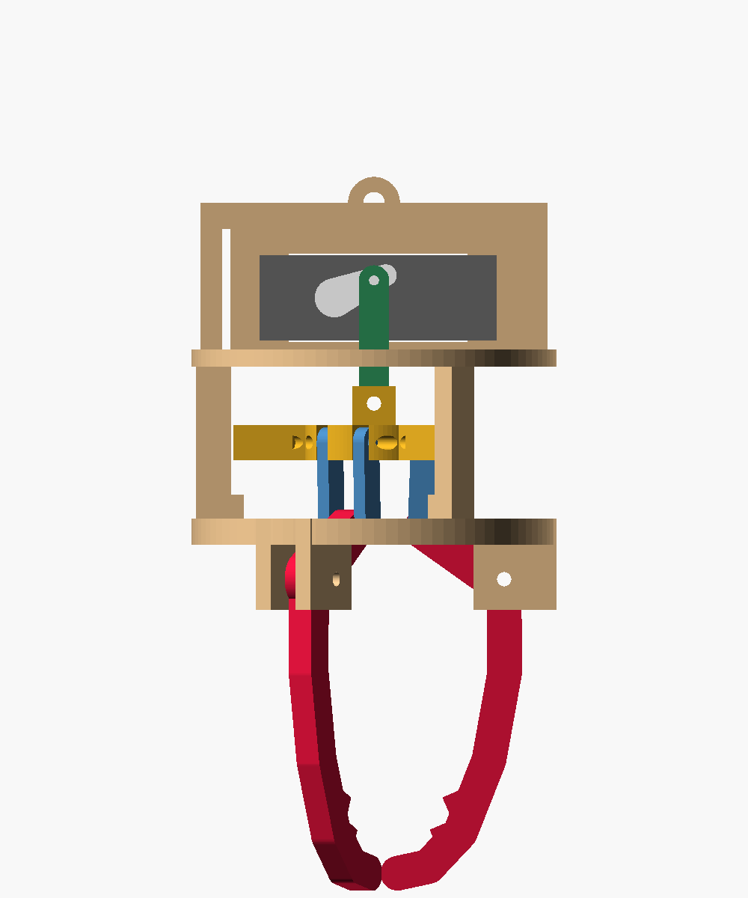
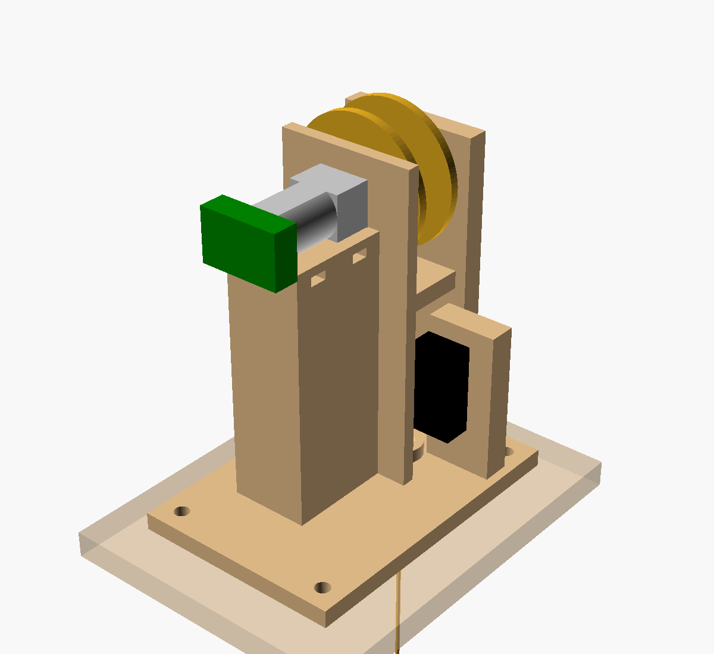

# Claw and drop winch

Two printed mechanisms for the carriage. The **claw** is three prongs driven by a standard MG996R servo. The **winch** is an N20 gearmotor with a Hall encoder, turning a spool that lowers the claw on 1.2 m of braided cable.

| Claw, open                 | Claw, closed (tips meet)       | Winch                   |
| -------------------------- | ------------------------------ | ----------------------- |
|  |  |  |

## How it works

**Claw.** The servo horn works as a crank. Its pin is 10 mm from the shaft and swings 47° (±23.6° about level), which moves a pushrod 8 mm vertically. The pushrod lifts the spider. Paired links on the spider raise each prong's inner lever, and the prongs swing 21.5° closed until the tips meet. The pushrod is close to vertical at both ends of the swing, so the spider rises straight, and the spider's stop tabs ride the posts.

**Grip.** A hobby servo pushes harder the further its commanded angle is past where it has stopped. The carriage MCU commands the servo past contact and reads the servo supply with an INA219. It then trims the command until the current matches the meter. That current is the grip: `GRIP <percent>` in `docs/hardware.md`.

**Winch.** The N20's D-shaft drives the spool directly, and the far end of the spool runs in a 683ZZ bearing. From the spool, the cable drops through a guide hole, past the roller of a KW12-3 switch, and out through the box floor. While the claw hangs, its weight pulls the cable straight and holds the switch closed. When the claw lands on a prize, the cable goes slack, the switch lever pushes it sideways, and the switch opens. That is the signal to stop the drop and close the claw. Homing at the top uses a stall: reel up at low power until the encoder stops counting.

## Files

- `claw.scad`: the claw. Set `part` to `assembly`, `frame`, `spider`, `prong`, `link`, `pushrod` or `print_plate`; `close` runs from 0 to 1.
- `winch.scad`: the winch. Set `part` to `assembly`, `base`, `spool`, `print_plate` or `section` (a cut through the cable line).
- `kinematics.py`: the prong linkage check. It agrees with the OpenSCAD solver at 21.5° for 8 mm.
- `check.sh` + `checks.scad`: claw interference checks open, half and at 7.5 mm, covering frame, prongs, spider, links, pushrod and servo. They all come back clear. The tips touch between 7.5 and 8 mm, and that contact is the closing stop.
- `winch_checks.scad`: base, spool, motor and switch interference checks. They all come back clear.
- `render.sh`: regenerates `out/*.png` and `stl/*.stl`.

## Key numbers

| What              | Value                                                                       |
| ----------------- | --------------------------------------------------------------------------- |
| Claw height       | 93 mm from the cable eye to the pivots, plus 72 mm prongs; ~80 mm open span |
| Servo swing       | 47° for the full 8 mm stroke                                                |
| Claw printed mass | 46–91 g (the 91 g is the solid volume) + 55 g servo + ~10 g screws          |
| Spool             | 12 mm core, 8 mm wide, 32 mm flanges; 1.2 m fits in 3 layers                |
| Winch load        | ~3.5 N with a 150 g plush, so ~0.03 N·m at the outer layer                  |
| Encoder           | 7 PPR × 4 edges × ~150:1 = ~4,200 counts per spool turn, ~0.01 mm/count     |
| Drop speed        | ~55–70 mm/s (100 rpm no-load, inner to outer layer)                         |

The winch load is about 0.3 kg·cm, a modest fraction of the 1 to 1.5 kg·cm stall torque that N20 1:150 listings give. I haven't checked that against a datasheet for the exact motor. The cable's effective radius grows by about 30% from the inner layer to the outer, so turn encoder counts into length with a per-layer table, and re-zero at the top on every lift.

The servo is far stronger than the claw needs. At 11 kg·cm on a 10 mm crank it can push about 100 N into the spider, roughly 10 N at each tip. The current loop is what keeps the grip fair, and a lower target is gentler on the servo.

## Measure before printing

The parts aren't bought yet, so these values come from listings and datasheets. Each one is marked `MEASURE` in the .scad files.

- **MG996R:** body 40.7 × 19.7 × 36.5 mm, case top to spline face, spline centre to the near end, tab position and thickness, and tab holes (49.5 × 10 mm). Listings disagree on hole spacing.
- **Horn:** which hole sits nearest 10 mm from the shaft (`crank_r`), plus hub and arm thickness. If your hole is at 12 mm, set `crank_r = 12` and the swing drops to 39°.
- **N20:** gearbox 12 × 10 × 9 mm, can length, encoder board size, the flat on the D-shaft, and the spacing of the M1.6 face holes (9 mm).
- **KW12-3:** body size, the hole position along the body, and the roller's free height. The switch screws sit in slots that give ±2 mm, so `slack_push` can be tuned on the bench.
- **Hang the claw** from its eye and move `eye_y` until it hangs level. The servo sits off-centre.

## Open issue: wires to the claw

The servo needs three wires, and they have to travel down the 1.2 m drop. They can't wind onto the spool without a slip ring. The simplest fix is a 3-core coiled cord from the carriage floor to the claw's bail, hanging beside the cable. I haven't designed that or picked one yet.

## Print (H2D, ASA)

| Part        | Qty | Orientation                       | Supports                              |
| ----------- | --- | --------------------------------- | ------------------------------------- |
| frame       | 1   | Upright, clevis cheeks on the bed | Yes, under the deck, ring and bail    |
| spider      | 1   | Flat                              | Under the pin holes                   |
| prong       | 3   | On its side                       | No                                    |
| link        | 6   | Flat                              | No                                    |
| pushrod     | 1   | Flat                              | No                                    |
| winch-base  | 1   | Flat on the bed                   | Bearing pocket, guide arm, motor bore |
| winch-spool | 1   | Motor-side flange down            | No                                    |

The clearances are 0.3 mm radial on pins and bores and 0.6 mm between moving plates. Print a link and the spool first: check that the M3 pins turn freely and that the spool goes onto the N20 shaft with a light press.

## Buy (Amazon)

The listings were found on 2026-10-29. Specs vary by seller, so check the variant before ordering.

| Part                                       | Qty  | Listing                                                                                                                                                                                                                                                 |
| ------------------------------------------ | ---- | ------------------------------------------------------------------------------------------------------------------------------------------------------------------------------------------------------------------------------------------------------- |
| MG996R servo, metal gear (4-pack)          | 1    | [Deegoo-FPV 4-pack](https://www.amazon.com/4-Pack-MG996R-Torque-Digital-Helicopter/dp/B07MFK266B)                                                                                                                                                       |
| N20 6 V 100 rpm gearmotor with encoder     | 1    | [N20 encoder motor, choose 100 rpm / 6 V](https://www.amazon.com/clp/B0B81VH5XQ) · 12 V version: [uxcell GA12-N20](https://www.amazon.com/uxcell-Motor-Encoder-Velocity-Measurement/dp/B0BPM1MTZQ) (too high for the DRV8833, which tops out at 10.8 V) |
| KW12-3 roller lever switch                 | 1    | [HiLetgo 10-pack](https://www.amazon.com/HiLetgo-KW12-3-Roller-Switch-Normally/dp/B07X142VGC)                                                                                                                                                           |
| 683ZZ bearing 3 × 7 × 3                    | 1    | [uxcell 683ZZ](https://www.amazon.com/uxcell-Bearing-Double-Shielded-Bearings/dp/B0H7TCWCRR)                                                                                                                                                            |
| INA219 current sensor                      | 1    | [DORHEA 10-pack](https://www.amazon.com/DORHEA-Interface-Bi-Directional-Monitoring-Breakout/dp/B09PDFCBB6)                                                                                                                                              |
| XL4015 5 A buck, set to 6 V                | 1    | [JacobsParts XL4015](https://www.amazon.com/JacobsParts-Voltage-Converter-Constant-Adjustable/dp/B078JTR9GM)                                                                                                                                            |
| A DS3218 20 kg servo instead of the MG996R | opt. | [DIYmall DS3218](https://www.amazon.com/DIYmall-DS3218-Digital-180Degree-Resistant/dp/B0BWNC1D8Q): same footprint, so re-measure the tab height                                                                                                         |

Screws: M3 × 20 + nylock ×3 (prong pivots), M3 × 16 + nylock ×4 (link pins and spider/pushrod), M3 × 12 + nut ×4 (servo tabs), M3 × 12 (spool into the bearing), M2 × 10 + nut (horn to pushrod), M1.6 × 4 ×2 (N20 face), M2 × 10 + nut ×2 (switch), M3 + nuts ×4 (winch base through the box floor), zip ties ×2.

## Assembly

1. **Winch.** Screw the N20 to the motor wall with two M1.6 screws and zip-tie it into the cradle. Press the 683ZZ into the tower from outside. Push the spool onto the D-shaft, then put the M3 × 12 through the bearing into the spool's pilot hole.
2. Thread the cable through the anchor hole across the core and knot it. Wind it on, then run it down through the guide hole and the exit hole. Drill the carriage floor 8 mm under the exit.
3. Fit the switch with its roller against the cable. With a 150 g weight hanging, the switch should click closed. Lift the weight and it should open. If it doesn't, slide the switch in its slots.
4. **Claw.** Centre the servo (1500 µs) and fit the horn so the crank pin points along +x and sits level. Bolt the servo through the bracket wall, tabs on the horn side.
5. Pin the links to the spider, the prongs to the clevises, and the levers between their links. Pin the pushrod to the spider's centre clevis and to the horn.
6. Run the servo from −23.6° to +23.6°. The tips should meet at the closed end without the servo straining.
7. Tie the drop cable to the bail eye and hang the claw. Move `eye_y` if it tilts.
